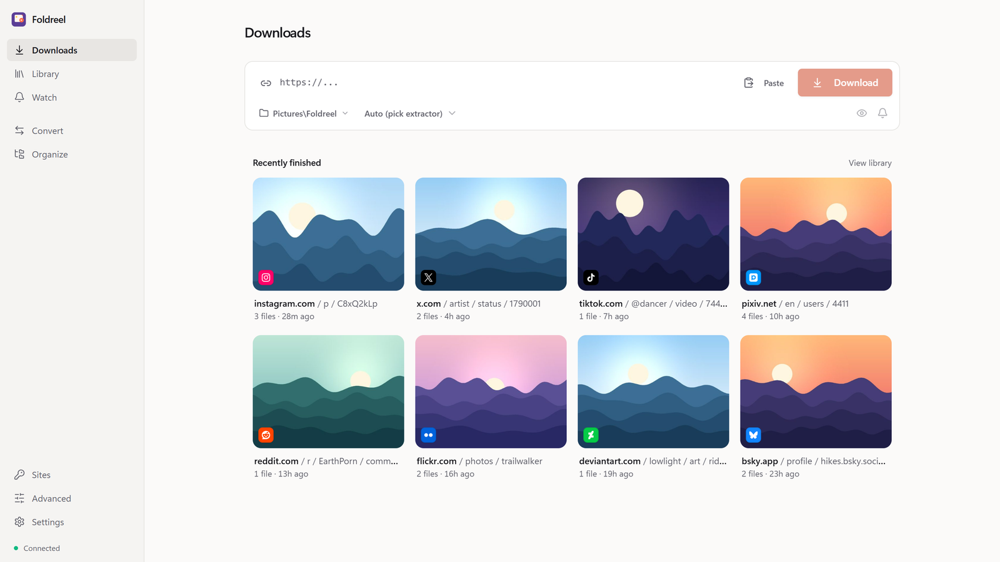
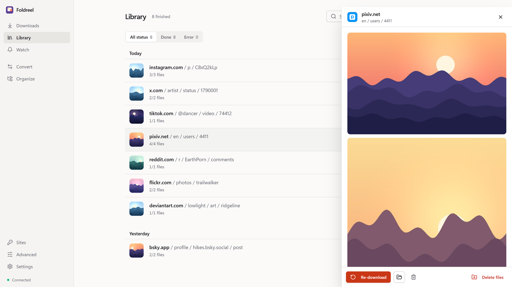
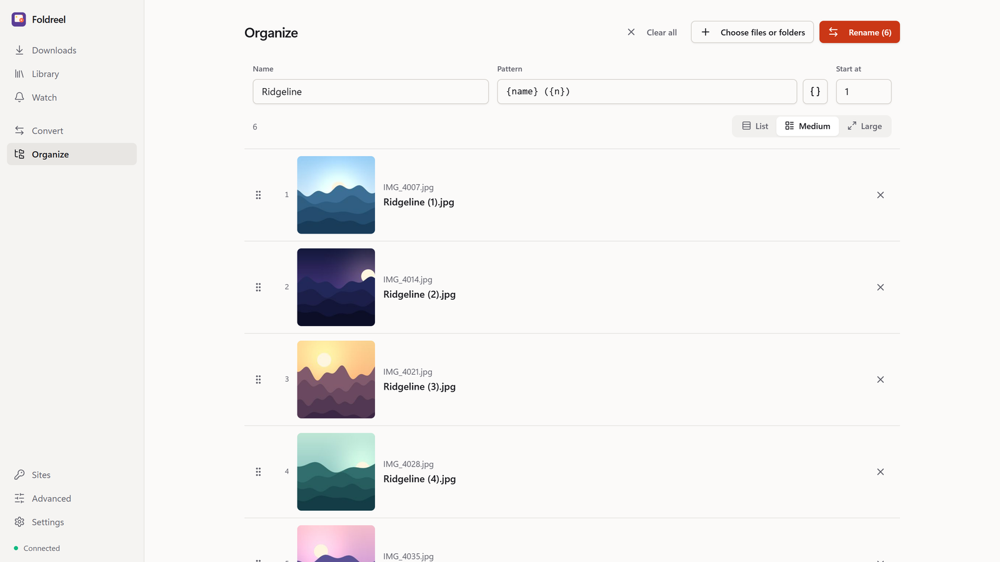
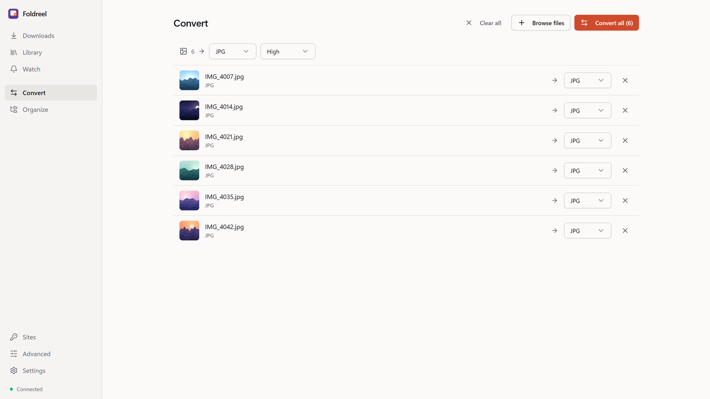
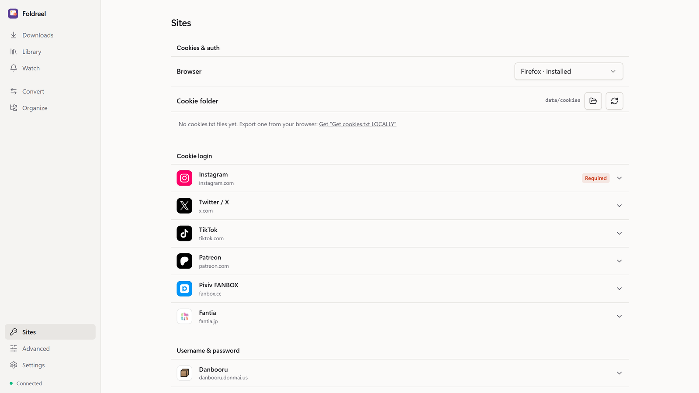
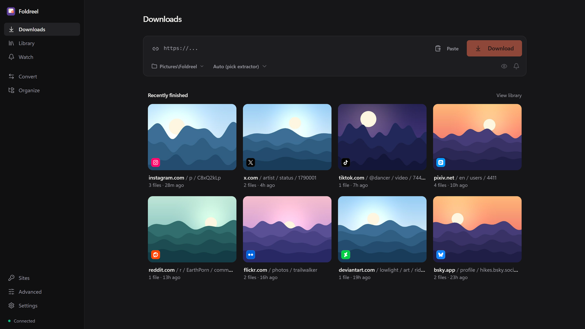
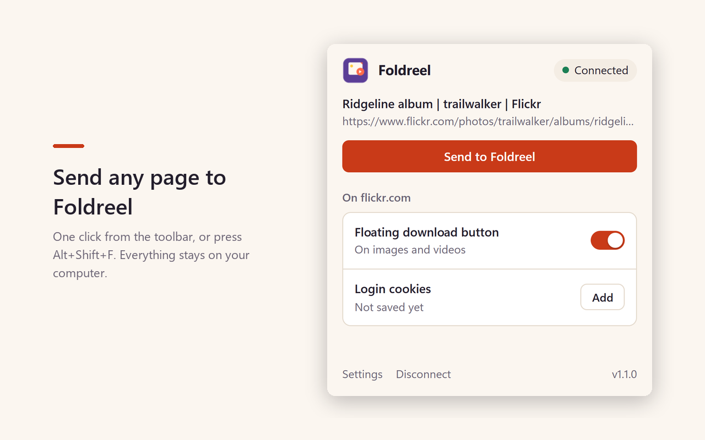
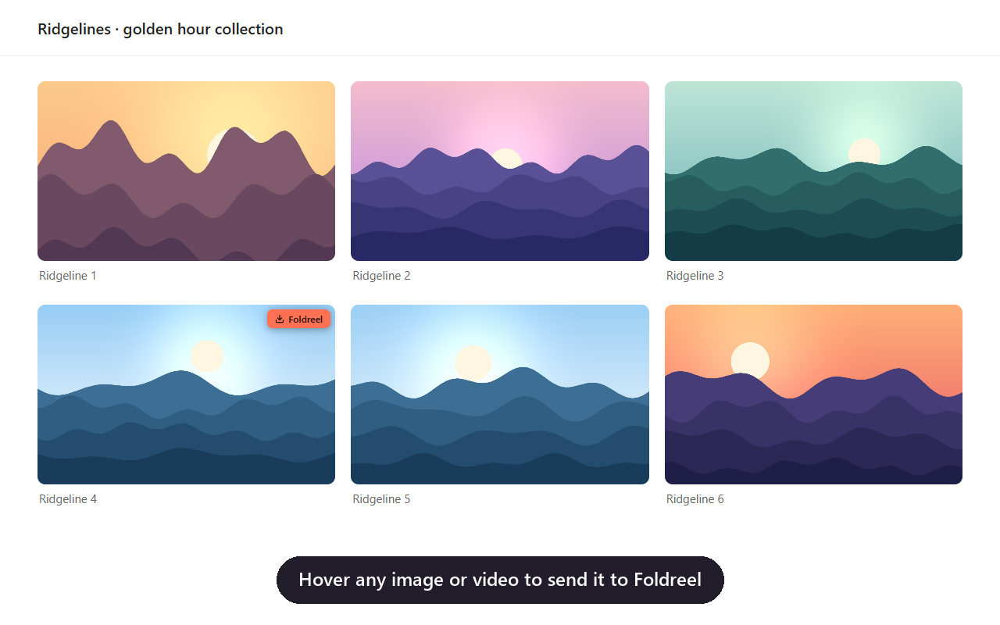

<div align="center">

# Foldreel

### Download. Convert. Rename. Watch. One app for your whole media library.

A native Windows desktop app that handles media end to end: pull full albums and videos from
your favorite sites, convert or compress anything you drop in, batch-rename files and folders
into clean albums, and watch pages for new posts automatically. No command line, no config
files, no juggling four different tools.

[](https://github.com/myousefg/Foldreel/releases/latest)
[](https://github.com/myousefg/Foldreel/releases/latest)
[](LICENSE)
[](https://github.com/myousefg/Foldreel/releases)

[Download](#download) &nbsp;&middot;&nbsp;
[Features](#features) &nbsp;&middot;&nbsp;
[Screenshots](#screenshots) &nbsp;&middot;&nbsp;
[Supported sites](#supported-sites) &nbsp;&middot;&nbsp;
[Browser extension](#browser-extension) &nbsp;&middot;&nbsp;
[FAQ](#frequently-asked-questions) &nbsp;&middot;&nbsp;
[Privacy](#privacy) &nbsp;&middot;&nbsp;
[Contributing](#contributing)

<br>



</div>

---

## Features

Four tools in one app, sharing one queue, library, and set of settings:

- **Download** full-resolution photos, videos, and galleries from 300+ sites.
- **Convert** photos and videos (HEIC, MOV, and more) to JPG, PNG, WebP, MP4, or GIF. Save a single frame of a video as a picture.
- **Organize** files and folders with bulk renaming, in whatever order you drag them.
- **Watch** a page on a schedule so new posts download themselves.

### Downloading

- **Paste and go.** Drop in one link or a list, one per line. Each link becomes its own job.
- **Full albums at full resolution.** Foldreel fetches the original files, not the compressed thumbnails a feed shows.
- **Live queue.** Progress for each download, with a streaming log.
- **Preview before you commit.** See what a link will download before it downloads anything.
- **Library.** Every finished download, grouped by day, with full-size previews, one click to open the folder, and one click to download it again.
- **Built-in logins.** Cookies, username and password, or OAuth, saved per site. You set each up once.
- **YouTube.** Pick a quality and format, audio-only included.
- **Automatic GIFs.** A Twitter/X "GIF" is a video file in disguise. Foldreel turns it into a real `.gif`.
- **Skip what you have.** Run the same link later and only new files download.
- **Watch a page.** Check any URL every 15 minutes to 24 hours and download only what is new.

### Converting and organizing

- **Convert or compress.** Drop in any photo or video, not only Foldreel downloads. Choose High, Normal, or Low quality to trade file size against detail. A separate GIF converter has its own frame rate, size, and time-range controls. Settings can apply a conversion to every future download.
- **Bulk rename.** Pick files or folders from anywhere on disk and drag them into order. View them as a list or as medium or large pictures so you can see which file is which, then rename them with a shared name and sequence. Every rename can be undone.
- **Import from Grabbr.** Bring over settings, history, watches, logins, and cookies. Foldreel only reads the old install and backs up its own data first.

### Everything else

- **A browser extension** sends the current tab to Foldreel, adds a hover button to images and videos, and shares a site's login cookies in one click. It also has a keyboard shortcut (Alt+Shift+F).
- **More than 40 languages**, with automatic detection and full right-to-left support.
- **Light, dark, or system theme**, with keyboard and screen-reader support.
- **Runs in the background.** Minimize to the tray and downloads continue.

Foldreel never touches gallery-dl configuration or caches already on your machine. It keeps its own data in its own folder.

---

## Screenshots

<table>
  <tr>
    <td width="50%"><br><sub><b>Library.</b> Full-size previews of everything you downloaded.</sub></td>
    <td width="50%"><br><sub><b>Organize.</b> Bigger previews show which file gets which name.</sub></td>
  </tr>
  <tr>
    <td width="50%"><br><sub><b>Convert.</b> One format and quality for the batch, or one per file.</sub></td>
    <td width="50%"><br><sub><b>Sites.</b> Logins and cookies for each site, in one place.</sub></td>
  </tr>
  <tr>
    <td width="50%"><br><sub><b>Dark theme.</b> Light, dark, or follow Windows.</sub></td>
    <td width="50%"><br><sub><b>Browser extension.</b> Send a page, or share a site's login.</sub></td>
  </tr>
</table>

The pictures in these screenshots are generated samples, not real downloads.

---

## Download

**Requires Windows 10 or 11, 64-bit.**

1. Grab the installer from the [latest release](https://github.com/myousefg/Foldreel/releases/latest).
2. Run `Foldreel-Setup-x.x.x.exe`. Since the app isn't code-signed yet, Windows SmartScreen may show
   a warning the first time. Click **More info**, then **Run anyway**.
3. That's it. No administrator permissions needed, and Foldreel launches automatically once
   installed.

Everything else is built in. gallery-dl, yt-dlp, FFmpeg, and aria2c ship inside the
installer, so nothing downloads after install. When a site changes, update the tools from
**Settings, About** without waiting for a new Foldreel release. (The Microsoft Store version updates
them together with the app instead.)

**Updating:** Foldreel checks for new releases automatically and lets you know from Settings. You
can also just download and run the latest installer at any time; it upgrades your existing
install in place.

**Uninstalling:** remove it the normal way, from *Apps* in Windows Settings. Your downloaded
files are never touched, they live wherever you told Foldreel to save them.

---

## Supported sites

Foldreel supports every site [gallery-dl](https://github.com/mikf/gallery-dl) does, well over 300
in total. Most work instantly with no setup. A few need you to be logged in first, which you set
up once from the **Sites** page:

| What's needed | Examples |
| --- | --- |
| Nothing | Danbooru, e621, most boorus, public Reddit posts, direct image links |
| Login (cookies) | Instagram, Twitter/X, Patreon, Pixiv FANBOX, Fantia |
| Account (optional, raises limits) | DeviantArt, Flickr, Tumblr, Reddit, Mastodon, Pixiv |

Logging in takes one of three forms depending on the site, all handled from the same page:

- **Pick your browser.** Foldreel reads the cookies straight from a browser you're already logged
  into. No exporting anything.
- **Drop in a cookies file.** If you'd rather export a `cookies.txt`, Foldreel picks it up
  automatically.
- **Sign in through the site.** For sites that support it, a one-click **Authorize** button opens
  the site's own login page and stores the result for you.

---

## Browser extension

The extension sends the page you are on to Foldreel, so you can skip copying the link.

<p align="center"></p>

**Install**

1. Get it from the [Chrome Web Store](https://chromewebstore.google.com/detail/ipmdcekleimdpcnokecigllimfcjaekn), or download `Foldreel-Extension-x.x.x.zip` from the
   [latest release](https://github.com/myousefg/Foldreel/releases/latest), unzip it, open
   `chrome://extensions`, turn on **Developer mode**, and choose **Load unpacked**. Edge and Brave work the same way.
2. In Foldreel, open **Advanced**, then **Extension**, and turn it on. Copy the pairing code.
3. Click the Foldreel icon in your browser toolbar, paste the code, and choose **Connect**.

**Use**

- Click the toolbar icon, or press **Alt+Shift+F**, to send the current page.
- Right-click a link, image, or video and choose **Send to Foldreel**.
- Hover an image or video to show a **Foldreel** button on it. Turn the button off for a single site from the popup, or everywhere from the extension's settings page.
- Choose **Add** in the popup to share your login for the current site. If Foldreel already has that site's cookies, the button reads **Replace**.

The extension talks only to Foldreel on your own computer, at `127.0.0.1`. It reads cookies only when you press the cookie button. See [extension/README.md](extension/README.md) for details.

---

## Frequently asked questions

### Downloads from Chrome, Edge, or Brave aren't working

Chromium-based browsers lock their cookie file while they're running, so Foldreel can't read it.
Firefox doesn't have this problem. Your options, easiest first:

1. **Switch to Firefox** for the sites you need to be logged into. Log in once, point Foldreel at
   Firefox, and it works whether Firefox is open or closed.
2. **Fully close your Chromium browser** (including its tray icon) before downloading.
3. **Export a `cookies.txt` file** using a browser extension like "Get cookies.txt", and upload it
   on the Sites page. This works even while the browser stays open.

Foldreel shows a warning on the Sites page when this is likely to be the problem.

### Instagram downloads suddenly stop working

If you retry the same profile too many times in a short window, Instagram temporarily blocks your
IP address, even with valid cookies. Wait 30 to 60 minutes, and consider turning on **Sleep
between requests** in Settings to space out future downloads.

### Do I need to keep my browser open?

No, as long as you've logged into the site at least once so the cookie exists (Firefox users can
close it entirely; Chromium users just need it closed while downloading, see above).

### Does Foldreel need to stay open?

While something is downloading, yes. Closing the window sends Foldreel to the system tray and your
downloads keep going in the background. Choose **Exit** from the tray icon to stop everything.

### Where are my downloaded files?

Wherever you set your download folder to, in Settings. That's completely separate from Foldreel's
own data (your saved logins, history, and settings), which lives in your Windows user profile and
never mixes with your media.

---

## Privacy

Foldreel has no account, no analytics, and no server of ours. Your settings, history, and logins stay in a folder on your computer. The only requests it makes besides the ones you ask for are version checks to GitHub. Read the full [privacy policy](PRIVACY.md).

---

## Tools

Foldreel is built on top of a few excellent open-source projects, all bundled inside the
installer - nothing to install separately:

| Tool | What it's for |
| --- | --- |
| [gallery-dl](https://github.com/mikf/gallery-dl) | The engine behind almost every download |
| [yt-dlp](https://github.com/yt-dlp/yt-dlp) | Powers YouTube and other video-site downloads |
| [FFmpeg](https://github.com/FFmpeg/FFmpeg) | Converts files, including the automatic GIF conversion |
| [aria2](https://github.com/aria2/aria2) | Splits large video downloads into parallel connections |

---

## Contributing

Issues and pull requests are welcome. For anything beyond a small fix, please open an issue first
to talk through the approach.

### Running it locally

You'll need [Node.js](https://nodejs.org) 18+, [Python](https://python.org) 3.10+, and Yarn
(`npm install -g yarn`).

```bash
scripts\dev.bat
```

This installs everything needed and opens Foldreel in development mode. React changes hot-reload;
changes to `backend/server.py` or the Electron files need a restart.

Building an installer additionally needs `bin/gallery-dl.exe`, `bin/yt-dlp.exe`, `bin/ffmpeg.exe`,
`bin/ffprobe.exe`, and `bin/aria2c.exe` (bundled into the app itself, so not checked into git):

```bash
scripts\fetch-bin-tools.ps1
scripts\build-exe.bat
```

### Project layout

```
foldreel/
├── electron/       Desktop shell: window, tray, backend process management
├── frontend/       React UI (pages, components, state)
├── backend/        Python/FastAPI download engine
├── extension/      The companion browser extension
├── docs/           Screenshots used in this README
└── scripts/        Dev and build scripts
```

To build an installer yourself, run `scripts\build-exe.bat`.

### Running the tests

```bash
python -m pytest backend/tests
cd frontend && yarn test --watchAll=false
```

---

## License

Foldreel is released under the [MIT License](LICENSE). The tools it uses under the hood
(gallery-dl, yt-dlp, FFmpeg) keep their own separate licenses.
